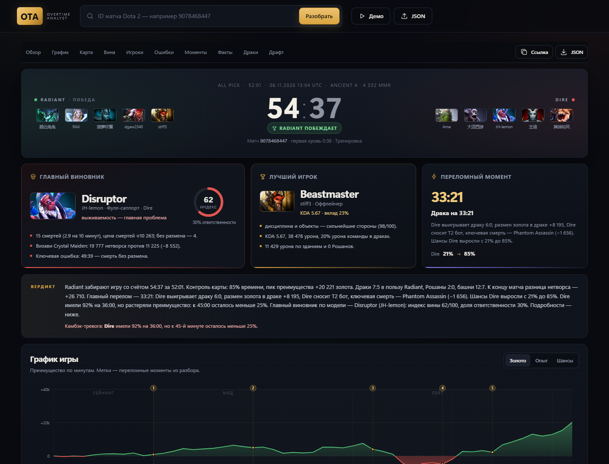

# OTA — Overtime Analyst

Разбор матча Dota 2 по данным распарсенного реплея: кто виноват больше, кто меньше, главные ошибки и переломные моменты.

Сайт на Python + HTML/CSS/JS без сборки. Данные матча берутся из OpenDota, а если матч ещё не распарсен — сервер сам скачивает `.dem` с серверов Valve и разбирает его локальным парсером [gem-dota](https://pypi.org/project/gem-dota/). Графики и карточки рисуются локально.



## Что внутри отчёта

- **Вердикт** — главный виновник с индексом 0–100 и долей ответственности, лучший игрок, главный перелом.
- **График игры** — преимущество по золоту/опыту и вероятность победы по минутам, с метками переломных моментов.
- **Кто виноват** — ролевые оценки по шести категориям, объяснение цифрами и сравнение с визави.
- **Игроки** — 10 карточек: KDA, GPM/XPM, нетворс, ЛХ/ДН на 10-й, урон, здания, драки, вижн, предметы, смерти, ошибки.
- **Ошибки и цена** — смерти без размена, смерти при преимуществе, байбеки, потерянные объекты, провал вижна, BKB без использования. У каждой ошибки есть тайминг, severity и цена в золоте.
- **Переломные моменты** — окна 2–3 минуты с максимальным изменением шансов, с драками, Рошаном и ключевыми смертями.
- **Команды и линии** — сравнение команд и итоги трёх линий.
- **Драки** — таблица командных боёв: счёт, размен золота, лучший игрок.
- **Карта** — карта Dota 2 с точками смертей в драках и вардов, фильтр по времени.
- **Чекпоинты** — нетворс и ЛХ на 10/20/30-й минуте плюс перцентили героя.
- **Драфт** — пики, баны, состав по контролю/инициации.
- **Факты** — руны мудрости, чат матча, глифы (если API их отдаёт), средний ранг по MMR и чекпоинты игроков.
- **Метод** — прозрачное описание формул и ограничений.

## GitHub Pages

Статическая демо-версия: **https://toidqwe.github.io/dota2webanalyzer/**

На Pages доступны готовые разборы `9078468447`, `9078923915`, `9074607307`.
Полный парс нового матча по ID, загрузка JSON и локальный парсер требуют Python-бэкенда: GitHub Pages умеет отдавать только статические файлы.

### Полная версия с парсером

1. Задеплойте бэкенд на Render одной кнопкой:

   https://render.com/deploy?repo=https://github.com/toidqwe/dota2webanalyzer

   В репозитории уже есть `Dockerfile` и `render.yaml`. Для парсинга 40-минутного реплея лучше брать план с 1–2 ГБ RAM: бесплатные 512 МБ могут не хватить.

2. Получите URL сервиса, например `https://ota-api.onrender.com`.

3. Откройте в репозитории файл `docs/config.js` и укажите адрес:

   ```js
   window.OTA_API_BASE = "https://ota-api.onrender.com";
   ```

   GitHub Pages подхватит изменение после коммита, пересобирать вручную не нужно.

4. Проверьте бэкенд: `https://ota-api.onrender.com/api/health` — должен вернуть `{"ok": true}`.

После этого сайт на Pages принимает любой ID: фронтенд шлёт запрос на бэкенд, тот скачивает и парсит реплей.

### Сборка страницы

```powershell
python tools/build_pages.py
```

Она пересобирает `docs/` — именно эту папку публикует GitHub Pages.

## Быстрый старт

Нужен Python 3.10+ (проверено на 3.14).

```powershell
pip install -r requirements.txt
python server.py 8765
```

Откройте `http://127.0.0.1:8765`:

- **Демо** — заранее разобранный матч `9078468447` (52 минуты, камбэк, 90 убийств), работает без интернета.
- **ID матча** — введите ID: если OpenDota уже распарсила матч, отчёт откроется сразу; если нет, сервер сам скачает реплей и запустит парсер (2–10 минут).
- **JSON** — загрузите JSON матча из OpenDota API, если он уже скачан.

Или запустите `run.bat`: он поднимет сервер и откроет браузер.

### Первый парс

- Скачивается `.dem` (~100 МБ) с `replay{cluster}.valve.net`, файл удаляется после успешного разбора.
- Парсинг идёт локально, на CPU: 2–10 минут для 40-минутного матча (на слабом CPU дольше).
- Готовый отчёт кэшируется в `data/cache/`, повторное открытие мгновенное.
- Прогресс виден на странице: «Скачиваем реплей → Парсим реплей → Собираем отчёт».

### Опционально: ключ OpenDota

Если API ограничивает частоту запросов:

```powershell
$env:OPENDOTA_API_KEY = "ваш_ключ"
python server.py 8765
```

## Про `.dem`-файлы

Сайт **не отправляет пользователя на OpenDota за парсом**. Логика такая:

1. Запрашиваем матч у OpenDota.
2. Если матч уже распарсен — сразу считаем отчёт.
3. Если нет — берём `replay_url`, при необходимости меняем региональный CDN на `replay{cluster}.valve.net`, скачиваем `.dem.bz2`, распаковываем и парсим через `gem-dota`.
4. Готовый отчёт кладём в кэш, `.dem` удаляем.

Ручная загрузка `.dem` не нужна: вставьте ID матча. Кнопка **JSON** осталась для случаев, когда JSON уже есть локально или матч нужно разобрать офлайн.

Что может пойти не так:

- **Valve удалила реплей** — обычно через 7–10 дней; тогда сайт честно скажет, что матч разобрать нельзя. Это ограничение Valve, а не сайта.
- **Региональный CDN недоступен** — сервер пробует canonical-хост `replay{cluster}.valve.net`.
- **Парсер не установлен** — выполните `pip install -r requirements.txt`.

Локальный парс не тянет бенчмарки OpenDota по герою, поэтому оценки опираются на ролевые нормы; поминутные графики, KDA, нетворс, здания, драфт и драки совпадают с OpenDota.

## API

| Метод | Путь | Описание |
|---|---|---|
| `GET` | `/api/health` | Проверка сервера |
| `GET` | `/api/demo` | Разбор демо-матча |
| `GET` | `/api/analyze?id=9078468447` | Скачать матч с OpenDota и разобрать |
| `POST` | `/api/replay` | Запустить локальный парс `.dem` (body: `{"id": 9078468447}`) |
| `GET` | `/api/replay/{id}` | Статус парса: стадия, прогресс, ошибка, готовый отчёт |
| `POST` | `/api/analyze` | Разобрать JSON матча из тела запроса |
| `GET` | `/api/history` | Последние разборы (локальный кэш) |

Кэш: `data/cache/{match_id}.json` (сырой матч) и `data/cache/{match_id}.analysis.json` (готовый отчёт). Ошибки возвращаются как `{"ok": false, "error": "..."}`.

## Как считается

### Роли

Позиция берётся из `position_est` OpenDota, при отсутствии — эвристика по линии и фарму (актуально для локального парса). Дальше для каждой позиции свои нормы GPM, XPM, ЛХ на 10-й, смертей, урона, вардов и т.д.

### Шесть категорий

Каждая оценка — 0–100, где 50 ≈ норма для роли:

- **Экономика** — GPM, XPM, ЛХ/ДН на 10-й, доля нетворса команды.
- **Бой** — урон по героям в минуту, участие в драках, KDA, kill participation.
- **Выживаемость** — смерти на 10 минут, доля смертей команды, цена смертей, дорогие смерти.
- **Вижн** — обсы, сентри, деварды, стаки (для кора вес минимальный).
- **Объекты** — урон по зданиям, добивания зданий, Рошаны.
- **Дисциплина** — смерти без размена, смерти при преимуществе, смерти после байбека, «фармил, пока команда умирала».

Оценки смешиваются с бенчмарками OpenDota по герою (где они есть), затем взвешиваются по роли. Для локального парса бенчмарков нет — остаются ролевые нормы.

### Индекс вины

```
raw_blame = 100 − взвешенная оценка
+ штраф за ошибки (до 20)
+ штраф за лишние смерти относительно ролевой нормы (до 12)
```

Доля ответственности нормируется внутри проигравшей команды и усиливает разрыв между игроками. Для победителей считается «заслуга» по тем же категориям.

### Вероятность победы

Логистическая функция от преимущества в золоте и опыте:

```
P(Radiant) = 1 / (1 + exp(−(gold_adv + 0.35 × xp_adv) / scale))
scale = 1700 + 85 × minute
```

Шансы ограничены 2–98%. Переломный момент — окно 2–3 минуты с максимальным изменением вероятности (не менее 8.5 п.п.).

### Цена смерти

```
gold_lost + gold_fed + time_dead × GPM / 60
```

То есть фактически потерянное золото, отданное врагам золото и недополученный фарм за время смерти.

## Структура

```
server.py              HTTP-сервер, кэш, OpenDota, статика
analyzer/
  normalize.py         нормализация матча, смерти, драки, объекты
  from_replay.py       адаптер gem-dota → формат OpenDota
  metrics.py           оценки игроков, вина/заслуга, команды, линии
  mistakes.py          эвристики ошибок
  moments.py           вероятность победы, переломы, фазы
  report.py            сборка JSON-отчёта и текстов
  constants.py         нормы, веса, таблицы
  format.py            форматирование чисел/времени/плюрализация
web/
  index.html           разметка и лендинг
  style.css            тёмная тема, адаптив
  charts.js            SVG-графики и радары без зависимостей
  app.js               рендер отчёта, фильтры, роутинг, прогресс парса
data/
  demo_match.json      демо-матч
  heroes.json          герои
  items.json           предметы
  cache/               кэш матчей и отчётов (создаётся)
  replays/             временные .dem (создаётся, чистится)
tools/
  analyze_cli.py       разбор из консоли
  selftest.py          смоук-тест движка
requirements.txt       gem-dota
```

## Ограничения

- Модель не знает коллов, связи и микро-решений — это эвристика по событиям, а не приговор.
- OpenDota может отдавать неполный парс (нет драк/бенчмарков/чата) — отчёт помечает это.
- Нормы и веса зашиты для текущего патча; при сильном изменении меты их стоит пересмотреть в `analyzer/constants.py`.
- Публичный OpenDota API имеет лимиты; для нагрузки используйте ключ и кэш.
- Матчи с `picks_bans`, где часть пиков не совпадает с игроками (тренировочные лобби), очищаются: неигровые герои уходят в баны.

## Ограничения данных

- **Руны мудрости** считаются по ключу `8` в логе рун; для локального парса — по событиям `PICKUP_RUNE` из combat log.
- **Чат** берётся из реплея. Это сырой лог, а не модерация: оскорбления не фильтруются.
- **Глифы** публичный API не отдаёт: OpenDota не публикует событие активации, в combat log его тоже нет. Раздел поддерживает событие, если оно когда-нибудь появится в данных, иначе показывает пустое состояние.
- **История репортов и behavior score** недоступны: Valve не отдаёт их через публичный API. Вместо этого показываем события этого матча — пинги, сообщения, ливы, паузы — и честно помечаем их как эвристику.
- **Средний ранг** — по `rank_tier` и `computed_mmr` игроков. В нерейтинговых матчах и на скрытых профилях данных может не быть.
- **Смерти** синхронизируются: если `deaths` в KDA и лог смертей расходятся, отчёт использует лог и помечает это в качестве данных. Так KDA, карточка и таблица смертей всегда совпадают.
- Глифы и репорты — единственные пункты из списка, которые нельзя достать из открытых данных; всё остальное считается по реплею.


## Лицензия данных

Данные матчей — OpenDota (открытый проект). Изображения героев и предметов — Valve/Steam CDN. Проект не связан с Valve.
=======

